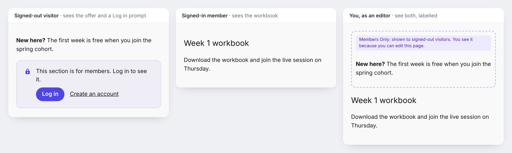

# Members Only

**A block that shows what's inside it only to the right people (signed-in visitors, signed-out visitors, chosen roles, MemberPress members or LearnDash students) and shows everyone else a short sign-in message.**

"Show this part of the page only to logged-in users" is one of the most common block editor questions, and WordPress still has no answer for it. Core's block visibility (6.9) hides a block from everyone, and the per-device option planned for 7.0 hides it on phones or desktops. Neither knows who is signed in. So people paste shortcodes into Classic blocks, set up a whole membership plugin's rules engine for one paragraph, or make a second page. Members Only is a container block: drop it in, put any blocks inside, choose who sees them.



*The course and cohort in the screenshot are made up.*

## Why it's nice to use

- **Works on activation.** No settings page. Add the **Members Only** block, put your blocks inside it and pick an audience in the sidebar.
- **Covers the usual cases in one block.** Signed-in visitors, signed-out visitors (for "New here? Join us" offers), chosen roles, and, when they're active, MemberPress memberships and LearnDash course enrollment.
- **Everyone else gets a clear next step.** By default, people who can't see the section get a small box with a lock icon and your message. Signed-out visitors also get a **Log in** button that brings them back to the same page, plus **Create an account** if registration is open. Or switch the message off and the section simply isn't there.
- **You can always check your work.** People who can edit the page still see hidden sections on the front end, inside a dashed outline with a label like "shown to signed-out visitors", so a page never looks broken to the person building it.
- **Clear in the editor.** The section has a dashed outline and a bar that reads, for example, "Shown to: Editor, Author". It turns amber with a warning if you pick "Chosen roles" but no role, because then nobody would see it.
- **Fails closed.** The check happens in PHP on every request, so hidden blocks never reach the page source. If MemberPress or LearnDash is deactivated, sections limited to them are hidden instead of shown to everyone. Automatic excerpts skip the section too.
- **Never breaks your site.** Every MemberPress and LearnDash call is guarded with `class_exists()`/`function_exists()`.
- **Accessible.** The message is a real paragraph with a real link, the lock icon is hidden from screen readers, links have visible focus outlines, and the layout stacks on narrow screens.

## Usage

1. Activate the plugin.
2. In the block editor, add **Members Only** (search "members", "logged in" or "restrict").
3. Add any blocks inside it.
4. In the sidebar under **Who can see this**, choose:
   - **Signed-in visitors**: anyone with an account who is logged in.
   - **Signed-out visitors**: good for sign-up offers that members don't need to see.
   - **Chosen roles**: tick one or more roles.
   - **MemberPress members**: tick memberships; anyone with an active subscription to one of them sees it. (Shown when MemberPress is active.)
   - **LearnDash students**: tick courses; anyone with access to one of them sees it. (Shown when LearnDash is active.)
5. Under **Everyone else**, keep **Show a short message instead** on and write your own message, or leave it empty for "This section is for members. Log in to see it."

It works in posts, pages and block-theme templates.

**Page caching:** most caching plugins and hosts don't cache pages for logged-in users, which is what this block needs. If yours caches pages for signed-in people too, exclude the pages that use the block.

## For developers

| Hook | Type | What it does |
| --- | --- | --- |
| `members_only_can_view` | filter | Final say on whether a user sees a section (`$can`, `$args` with `audience`, `roles`, `memberships`, `courses`, `$user_id`). Use it to add your own rules. |
| `members_only_show_to_editors` | filter | Whether people who can edit the post see hidden sections with a label. Default `true` (`$show`, `$args`, `$post_id`). |
| `members_only_prompt_html` | filter | Change the message box, or return `''` to show nothing (`$html`, `$args`, `$user_id`). |

Let a paid WooCommerce customer see "signed-in" sections only after their first order:

```php
add_filter( 'members_only_can_view', function ( $can, $args, $user_id ) {
	if ( $can && 'members' === $args['audience'] && function_exists( 'wc_get_customer_order_count' ) ) {
		return wc_get_customer_order_count( $user_id ) > 0;
	}
	return $can;
}, 10, 3 );
```

How it works: the section's blocks are saved in the post like any other container block. A PHP `render_callback` checks the current visitor and returns either those blocks, the message, or nothing. The editor sidebar gets the site's roles, memberships and courses from an inline script printed only on block editor screens. MemberPress access uses `MeprUser::is_already_subscribed_to()`, and LearnDash access uses `sfwd_lms_has_access()`.

This block controls what a page shows. It doesn't protect files or whole posts: a PDF linked inside the section can still be downloaded by anyone who has the link. Use your membership plugin's rules for those.

## Install

1. Download the [toolbox repository](https://github.com/memberfixstudio-ind/wordpress-toolbox) as a ZIP and unzip it.
2. Zip the `members-only/` folder.
3. In WordPress go to **Plugins → Add New → Upload Plugin**, upload it and activate it.

Requires WordPress 6.5+ and PHP 7.4+. No build step. It's plain PHP, CSS and JavaScript.

## Files

```
members-only.php       Block registration, access checks, render callback, message box
block.json             Block metadata (apiVersion 3)
assets/editor.js       Editor: container, sidebar controls, "Shown to" bar
assets/editor.css      Editor outline and bar
assets/style.css       Front-end message box and the editor-only label
```

## License

GPL-2.0-or-later. Built by [Rohan Salave](https://www.linkedin.com/in/rohan-salave-362475189/).
