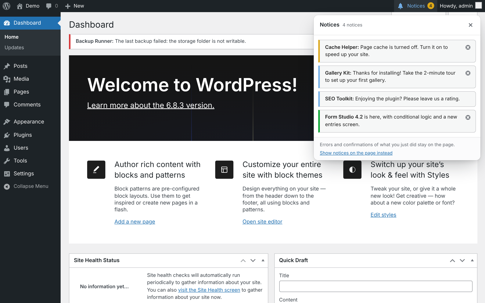

# Notice Tray

**Moves the pile of plugin and theme notices off the top of every admin screen into one tidy tray in the admin bar.**

Install a handful of plugins and every wp-admin screen starts with a stack of banners: welcome tours, "please rate us", upgrade offers and setup reminders. They push the actual screen down the page, they come back on every screen, and real problems get lost among them. Notice Tray collects them into a bell in the admin bar with a count, so you read them when you choose to.



*The notices in the screenshot come from a demo plugin with made-up names.*

## Why it's nice to use

- **Nothing to set up.** Activate it and the clutter is gone. There's no settings page.
- **Problems stay visible.** Errors, the "Settings saved" message, the "Post updated" message and inline notices stay on the page, because they are about something you need to act on or something you just did.
- **Nothing is thrown away.** Notices are moved, not hidden. Their links and dismiss buttons work in the tray, and the count goes down as you dismiss them.
- **Warnings stand out.** The count turns amber when a warning or a WordPress update notice is waiting, and warnings are listed first.
- **Keyboard and screen reader friendly.** The button says how many notices are waiting, focus moves into the tray when it opens, Escape closes it and returns focus to the button.
- **Each person decides.** *Show notices on the page instead* switches the tray off for you only. A *Tray off* link in the admin bar switches it back on.
- **Stays out of the block editor**, which already has its own notice area, and keeps working on phones.

## Usage

1. Activate the plugin.
2. Click **Notices** in the admin bar (the bell) to see what's waiting.
3. Dismiss what you've dealt with, or follow its link. Press Escape or click outside to close.

## For developers

Keep a notice on the page by giving it the `notice-tray-keep` class, or add selectors with a filter:

```php
add_filter( 'notice_tray_keep_selectors', function ( $selectors ) {
	$selectors[] = '.my-plugin-license-expired';
	return $selectors;
} );
```

Turn the tray off on particular screens:

```php
add_filter( 'notice_tray_enabled', function ( $enabled, $screen ) {
	return $screen && 'woocommerce_page_wc-orders' === $screen->id ? false : $enabled;
}, 10, 2 );
```

If your script adds notices to the tray after the page loads, trigger `jQuery( document ).trigger( 'notice-tray:refresh' )` to update the count. Removing or hiding a notice updates it automatically.

| Hook | Type | What it does |
| --- | --- | --- |
| `notice_tray_keep_selectors` | filter | CSS selectors for notices that always stay on the page |
| `notice_tray_enabled` | filter | Whether the tray runs on the current screen (`$enabled`, `$screen`) |
| `notice-tray:refresh` | jQuery event | Recount the notices in the tray |

The pause choice is stored per user in the `notice_tray_paused` user meta, and `uninstall.php` removes it when the plugin is deleted. Switching it goes through `admin-post.php` with a nonce, and the return address is checked with `wp_validate_redirect()`.

## Install

1. Download the [toolbox repository](https://github.com/memberfixstudio-ind/wordpress-toolbox) as a ZIP and unzip it.
2. Zip the `notice-tray/` folder.
3. In WordPress go to **Plugins → Add New → Upload Plugin**, upload it and activate it.

Requires WordPress 6.3+ and PHP 7.4+. No build step. It's plain PHP, CSS and JavaScript.

## Files

```
notice-tray.php           Admin bar button, per-user pause, script settings
uninstall.php             Removes the saved pause choice when the plugin is deleted
assets/notice-tray.js     Collects notices into the tray and keeps the count up to date
assets/notice-tray.css    Tray and badge styles
```

## License

GPL-2.0-or-later. Built by [Rohan Salave](https://www.linkedin.com/in/rohan-salave-362475189/).
