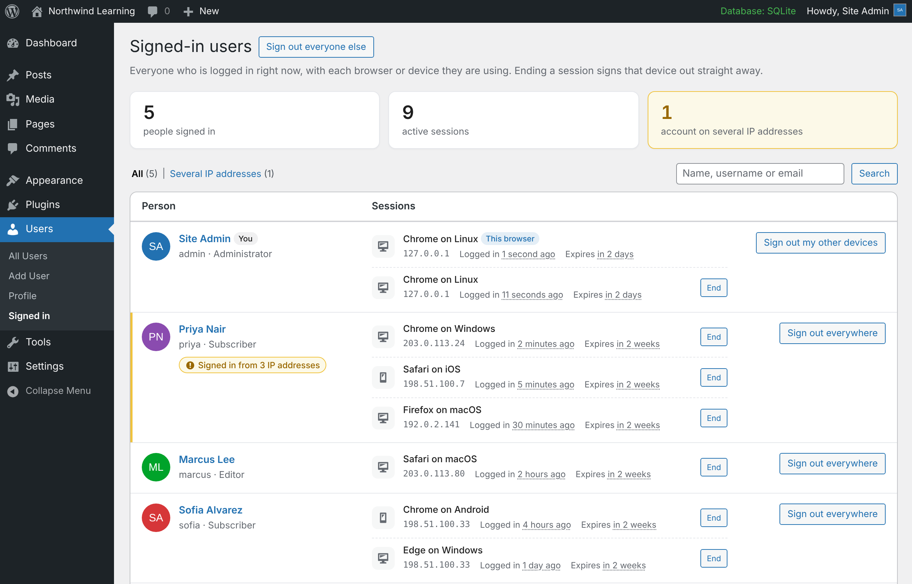

# Session Watch

**See who is signed in to your site right now, on which devices and from where, and sign out any of them in one click.**

WordPress keeps a list of every browser each person is logged in on, but only shows it to that person, on their own profile, as a single "Log Out Everywhere Else" button. As an admin you can't see who is signed in, you can't tell when one membership login is being used by several people, and after a password leak you can't sign one device out without changing the password. Session Watch adds **Users → Signed in**, a screen that lists every active session on the site and lets you end them.



*The people, IP addresses and site name in the screenshot are made up.*

## Why it's nice to use

- **Nothing to set up.** Activate it and open **Users → Signed in**. There's no settings page, and the plugin stores nothing of its own.
- **Readable at a glance.** Each session shows the device ("Safari on iOS", "Chrome on Windows"), the IP address, when it logged in and when it expires. Hover a time for the exact date in your site's timezone.
- **Shared logins stand out.** Accounts signed in from several IP addresses get an amber flag and their own filter, which is what membership and course sites watch for when one paid login is passed around. A note under the table reminds you it's a hint, not proof.
- **End exactly what you mean.** End one device, sign a person out everywhere, or sign out everyone except you after a security scare. The bigger actions ask first; ending one device doesn't, because that person can simply log in again.
- **You can't lock yourself out.** Your current browser is marked *This browser* and is never ended, even by *Sign out everyone else*.
- **Fits into the Users screen.** A *Signed in* column on **Users → All Users** shows each person's session count and links to their sessions.
- **Fast on big sites.** Reads every session with one database query and loads user details only for the people on the current page (or the signed-in people you search).
- **Accessible.** Real buttons and links, a captioned table, a label on every *End* button that names the device and person, and a layout that stacks on phones.

## Usage

1. Activate the plugin.
2. Go to **Users → Signed in**.
3. Use **Several IP addresses** or the search box to narrow the list, then **End** a device or **Sign out everywhere** for a person.

From **Users → All Users**, click a number in the *Signed in* column to see that person's sessions.

## For developers

| Hook | Type | What it does |
| --- | --- | --- |
| `session_watch_capability` | filter | Capability needed to open the screen. Default `edit_users`. Ending a person's sessions also needs `edit_user` for that person. |
| `session_watch_ip_threshold` | filter | How many different IP addresses flag an account. Default `2`. |
| `session_watch_device` | filter | Change how a device is described (`$device` with `label` and `type`, `$user_agent`). |
| `session_watch_sessions_ended` | action | Fires after sessions are ended (`$user_id`, `$count`, `$scope` of `one`, `user` or `others`). Useful for an audit log. |

Log every sign-out an admin makes:

```php
add_action( 'session_watch_sessions_ended', function ( $user_id, $count, $scope ) {
	error_log( sprintf( 'User %d ended %d session(s) of user %d (%s).', get_current_user_id(), $count, $user_id, $scope ) );
}, 10, 3 );
```

How it works: sessions are the ones WordPress already keeps in the `session_tokens` user meta. WordPress can only end a session when it has the browser's cookie token, so Session Watch extends core's `WP_User_Meta_Session_Tokens` class to end one session by its stored hash, using core's own storage code. Every action is a POST to `admin-post.php` with its own nonce and a capability check, and the return address is checked with `wp_validate_redirect()`.

If another plugin replaces the session storage through the `session_token_manager` filter, Session Watch says so and doesn't try to read or change it. On multisite, `edit_users` belongs to super admins, so by default only they see the screen.

## Install

1. Download the [toolbox repository](https://github.com/memberfixstudio-ind/wordpress-toolbox) as a ZIP and unzip it.
2. Zip the `session-watch/` folder.
3. In WordPress go to **Plugins → Add New → Upload Plugin**, upload it and activate it.

Requires WordPress 6.4+ and PHP 7.4+. No build step. It's plain PHP, CSS and JavaScript.

## Files

```
session-watch.php                         Screen, actions, Users column
includes/class-session-watch-tokens.php   Ends one session by its hash, using core's storage
assets/session-watch.css                  Screen styles
assets/session-watch.js                   Confirms the bigger sign-outs and blocks double submits
```

## License

GPL-2.0-or-later. Built by [Rohan Salave](https://www.linkedin.com/in/rohan-salave-362475189/).
